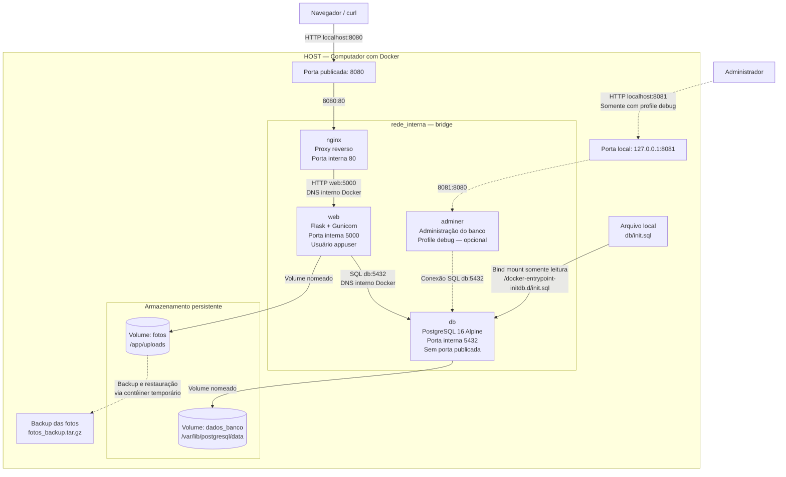

# Diagrama de Arquitetura — Achados & Perdidos



## Descrição

A aplicação Achados & Perdidos utiliza Docker Compose para
gerenciar os serviços nginx, web e db. Existe também o serviço
opcional adminer, ativado somente com o profile debug.

Todos os serviços estão conectados à rede bridge
personalizada rede_interna.

### Nginx — Proxy reverso

O Nginx é o ponto de entrada da aplicação.

Ele publica a porta 8080 do computador e encaminha
as requisições HTTP para o serviço web na porta 5000.

O serviço web não publica uma porta diretamente no host.

### Web — Flask e Gunicorn

O serviço web executa a aplicação Flask utilizando
o servidor Gunicorn.

A aplicação é executada com o usuário não privilegiado
appuser, definido no Dockerfile.

O serviço utiliza o nome db para localizar o PostgreSQL
por meio do DNS interno do Docker.

### Banco de dados — PostgreSQL

O serviço db utiliza a imagem postgres:16-alpine.

A porta 5432 é utilizada internamente, sem publicação
direta no computador.

O healthcheck verifica se o PostgreSQL está pronto para
receber conexões. O serviço web depende dessa condição
para ser iniciado pelo Docker Compose.

### Persistência dos dados

Dois volumes nomeados são utilizados:

- fotos: armazena as imagens enviadas pelos usuários
  no diretório /app/uploads.
- dados_banco: armazena os arquivos do PostgreSQL
  no diretório /var/lib/postgresql/data.

Esses volumes permitem preservar os dados mesmo após
a remoção e recriação dos contêineres, desde que os
volumes não sejam excluídos.

### Inicialização do banco

O arquivo db/init.sql é disponibilizado ao contêiner
do PostgreSQL por um bind mount somente leitura.

O script é executado automaticamente na primeira
inicialização de um diretório de dados vazio.

### Backup e restauração

Foi realizado um backup do volume fotos utilizando
um contêiner temporário com Alpine Linux e o comando tar.

O arquivo gerado foi salvo em:

docs/evidencias/fotos_backup.tar.gz

A restauração foi testada em um volume separado.
Os arquivos restaurados foram comparados com os
originais para verificar sua integridade.

### Adminer — Profile debug

O serviço adminer permite consultar e administrar
o banco PostgreSQL por uma interface web.

Ele utiliza o profile debug e não é iniciado durante
a execução normal do projeto.

Quando ativado, o painel fica disponível em:

http://localhost:8081

A publicação da porta é restrita ao endereço 127.0.0.1
do host, evitando sua exposição direta em interfaces
externas.

O Adminer se conecta ao PostgreSQL utilizando o
endereço db na rede Docker.

### Credenciais

As credenciais de acesso ao PostgreSQL são configuradas
por variáveis de ambiente.

O arquivo .env contém os valores locais e não deve
ser incluído no repositório nem no ZIP de entrega.

O arquivo .env.example contém apenas valores de exemplo.

## Serviços por modo de execução

Execução normal:

docker compose up -d --build

Serviços iniciados:
- db
- web
- nginx

Execução com ferramentas de administração:

docker compose --profile debug up -d

Serviços iniciados:
- db
- web
- nginx
- adminer
```
